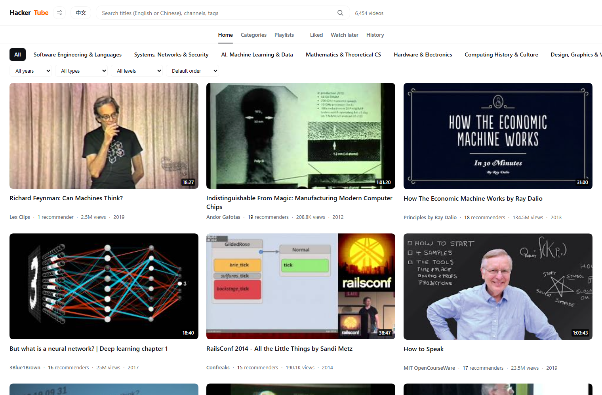
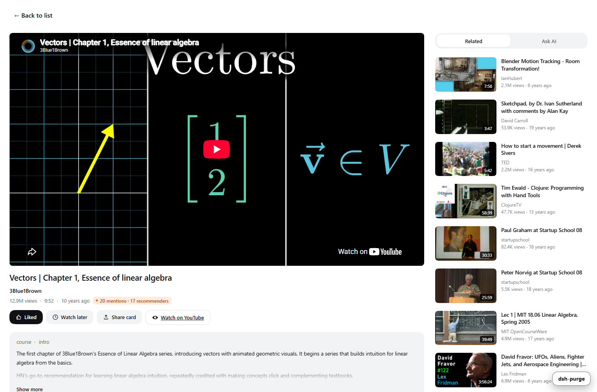
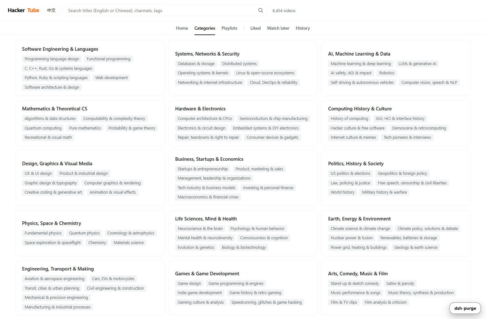

<div align="center">

# HackerTube for DeepSeek Harness

**Two Decades of Hacker News Top Technical Videos — Right Inside Your IDE**

[](https://www.npmjs.com/package/dsh-hackertube)
[](LICENSE)
[](https://nodejs.org)
[](https://github.com/chow651/dsh-hackertube)
[](package.json)

[English](README.en.md) | [简体中文](README.md)

<br />

<p align="center">
  No need to switch back and forth between editor tabs and a browser.<br />
  Browse and watch 6,454 high-impact engineering talks, lectures, and documentaries<br />
  recommended over twenty years on Hacker News, directly in your <b>DeepSeek Harness</b> workspace.<br />
  Featuring full bilingual support, subtitle-aware AI answers, and a native Agent search tool.
</p>



</div>

---

## ✨ Key Features

- 📺 **Seamless In-Editor Player**: Dedicated local relay avoids third-party embed and referrer restrictions. Watch high-value engineering talks side-by-side with your code without tab-switching.
- 🤖 **Subtitle-Aware AI Q&A**: Asking "what is this part about?" extracts the exact subtitle window around your current playhead (±3 mins) for grounded, precise technical explanations.
- 🇨🇳 **Built-in Bilingual Localization**: Ships with 6,454 Chinese titles and 166 taxonomy categories ready on install. Summaries and discussions support both on-demand model translation and machine translation fallback.
- 🔍 **Native Agent Tool**: Registers `hackertube_search` so your AI agent can query 20 years of HN technical recommendations directly inside coding conversations.
- 🎯 **Smart Alternative Mirrors**: Automatically identifies quality mirrors and subtitled versions on Chinese platforms (Bilibili) using strict physical duration fingerprints. Shows a direct entry only when found; remains completely silent otherwise.
- ⚡ **Zero Runtime Dependencies & Vector Recommendations**: Pure native Node.js implementation with 384-dimensional vector centroid recommendations. Fast cold starts and host-side persistence.

---

## 🚀 Quick Start

> **Prerequisite**: A running installation of [DeepSeek Harness](https://github.com/chow651/dsh-hackertube).

### Option 1: Let Your Agent Install It (Recommended)

Simply send this prompt to your agent inside DeepSeek Harness:

```text
Install and enable the HackerTube plugin: plugin_manager install_bundle target=dsh-hackertube.
If npm fails, use target=github:chow651/dsh-hackertube instead.
Then confirm dsh-hackertube is enabled in the plugin list and remind me to refresh the page.
```

### Option 2: Install via Plugin Manager

Run directly in the DSH terminal:

```bash
plugin_manager install_bundle target=dsh-hackertube
# Or directly from the GitHub repository:
# plugin_manager install_bundle target=github:chow651/dsh-hackertube
```

### Option 3: Manual Package Install

```bash
# Inside your DSH profile directory
npm install dsh-hackertube
# or
pnpm add dsh-hackertube
```

Enable `dsh-hackertube` in your plugin list and refresh the workspace. **No API keys or manual database initialization required.**

---

## 🤖 Native Agent Tool Integration

The plugin registers `hackertube_search` with DeepSeek Harness. Your agent can search the library semantically during development workflows:

### Example Exchange

> **You**: Is there any video explaining the Raft consensus algorithm? Ideally by the author.

**Agent** calls `hackertube_search({ query: "Raft consensus", limit: 5 })` and replies:

> Yes, Raft's author Diego Ongaro delivered a comprehensive lecture at Stanford: *Raft User Study Lecture* (58 min, recommended by 4 HN members). HN comments highlight that it is much more approachable than reading the paper alone. You can also watch the accompanying *Paxos Lecture* (67 min) for foundational background.
> 🔗 https://www.youtube.com/watch?v=YbZ3zDzDnrw

### Tool Parameters

| Parameter | Type | Required | Description |
|---|---|---|---|
| `query` | string | Yes | Search query in English or Chinese (e.g. `compiler optimization`, `micrograd`) |
| `limit` | number | No | Number of results to return (default `5`, max `15`) |
| `lang` | string | No | Language for returned text: `zh` (default) or `en` |

---

## 💡 Comparison with the Original Site

Built upon Andrej Karpathy's open [HackerTube data export](https://karpathy.bearblog.dev/hacker-tube/), tailored specifically for developer environments:

| Capability | Original Site | HackerTube DSH Plugin |
|---|---|---|
| **Context** | Standalone web browser | **Embedded inside DSH workspace** |
| **Localization** | English only | **Full EN/ZH bilingual**, 6,454 translated titles ready |
| **AI Q&A** | None | **Subtitle-aware temporal Q&A** |
| **Agent Tool** | None | **Native `hackertube_search` tool** |
| **Mirror Sources** | YouTube only | **Smart physical fingerprint matching for mirrors** |
| **State Persistence** | Ephemeral browser storage | **Host-side local persistence** (safe across cache clears) |
| **Recommendations** | None | **384-d vector centroid + HN co-recommendation graph** |
| **Offline Resilience** | Full network dependent | **Local caching + graceful offline degradation** |

---

## 🖥️ Watch Page & Shortcuts



### Keyboard Shortcuts

| Key | Action | Key | Action |
|---|---|---|---|
| `/` | Focus search bar | `j` / `k` | Navigate cards up/down |
| `Enter` | Open selected video | `l` | Like / Unlike |
| `w` | Add to Watch Later | `h` | Return to Home |
| `?` | Show shortcut cheatsheet | `Esc` | Close details or overlay |

### 🎯 Smart Alternative Mirrors

For users facing network restrictions or seeking localized subtitles, the watch view dynamically checks for verified Chinese platform (Bilibili) mirrors:

- **Strict Fingerprint Verification**: Compares exact duration (within ±2s tolerance), chronological release order, and bidirectional description references to rule out homonymous uploads or derivative commentary.
- **Tier Quality Ranking**: Prioritizes `Official Channel` → `Subtitled / Translated` → `High-definition Repost`.
- **Zero Noise & Silent Lookup**: Lookups are on-demand and cached locally. If no valid mirror exists, **no placeholder is rendered** — keeping the interface clean and distraction-free.

<details>
<summary><b>📂 Click to expand: 16 Core Knowledge Domains (6,454 Videos)</b></summary>

<br />



| Area | Subcategories | Videos |
|---|---:|---:|
| Software Engineering & Languages | 11 | 980 |
| Systems, Networks & Security | 10 | 702 |
| AI, Machine Learning & Data | 9 | 576 |
| Mathematics & Theoretical CS | 9 | 360 |
| Hardware & Electronics | 8 | 582 |
| Computing History & Culture | 8 | 1026 |
| Design, Graphics & Visual Media | 9 | 439 |
| Business, Startups & Economics | 9 | 644 |
| Politics, History & Society | 9 | 1018 |
| Physics, Space & Chemistry | 8 | 600 |
| Life Sciences, Mind & Health | 11 | 598 |
| Earth, Energy & Environment | 8 | 354 |
| Engineering, Transport & Making | 12 | 805 |
| Games & Game Development | 8 | 355 |
| Arts, Comedy, Music & Film | 12 | 1344 |
| Ideas, Learning & Language | 9 | 689 |

> Note: Cross-domain videos may belong to multiple categories, so category totals exceed 6,454.

</details>

---

## ⚡ Architecture & Performance

- **Zero Runtime Dependencies**: Archive unpacking uses Node.js native `zlib`; no third-party npm packages required at runtime.
- **Latency Benchmarks**:
  - Initial catalogue render: **~45 ms**
  - Watch view open: **~10 ms**
  - Co-recommendation query: **~2 ms**
  - Vector cosine neighbor search: **~0.7 s** on initial run, instant in-memory afterwards
- **Graceful Degradation**:

| Module | Requirements | Behavior When Missing / Offline |
|---|---|---|
| **Browsing & Basic Playback** | DSH Web Container & Network | Local offline search remains available |
| **Chinese Titles & Categories** | None | Shipped with repo, 100% offline available |
| **Summaries & Comment Translation** | Model or Translation Endpoint | Automatically falls back to English source |
| **AI Q&A** | Configured DSH model | Warns model unavailable; playback unaffected |
| **Subtitle Extraction** | Optional `yt-dlp` + `ffmpeg` | AI answers lose subtitle context; playback unaffected |
| **Alternative Mirror** | Domestic platform connectivity | Hides button silently; normal playback unaffected |

<details>
<summary><b>📁 Data Source & Local Cache Directory Layout</b></summary>

<br />

Cached under `$DSH_PROFILE_DIR/.dsh-hackertube/` (default: `~/.dsh/.dsh-hackertube/`):

```text
.dsh-hackertube/
├── export/               # Unpacked official export (~48 MB: videos, mentions, embeddings.npy)
├── i18n/                 # Translation caches (titles, taxonomy, model output, MT cache)
├── list.json             # YouTube metadata snapshot (views, duration, dates)
├── prefs.json            # Likes, watch later list, playback progress history
├── subs/                 # On-demand subtitle files
└── mirror.json           # Alternative mirror lookup cache
```

Delete this directory at any time to reset to a pristine state.

</details>

---

## 📌 Credits & Disclaimer

- Core data is powered by the [HackerTube](https://karpathy.bearblog.dev/hacker-tube/) project created by **[Andrej Karpathy](https://github.com/karpathy)**.
- Discussion snippets originate from [Hacker News](https://news.ycombinator.com). Video content copyright belongs to respective YouTube creators.
- This is an independent open-source plugin and is not officially affiliated with Andrej Karpathy, Hacker News, or YouTube.

---

## 📄 License

[MIT License](LICENSE) © 2026
