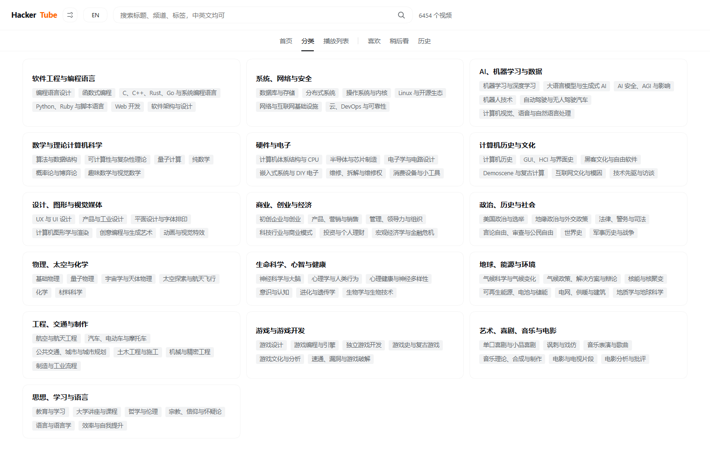

<div align="center">

# HackerTube for DeepSeek Harness

**将 Hacker News 二十年精选的 6,454 支高分技术视频搬进你的 IDE**

[](https://www.npmjs.com/package/dsh-hackertube)
[](LICENSE)
[](https://nodejs.org)
[](https://github.com/chow651/dsh-hackertube)
[](package.json)

[简体中文](README.md) | [English](README.en.md)

<br />

<p align="center">
  无需在编辑器与浏览器之间来回切换。<br />
  在 <b>DeepSeek Harness</b> 侧边栏畅享 Hacker News 社区精选的高质量技术演讲、AI 课程与系统架构视频。<br />
  开箱即用的全量中文、字幕级上下文 AI 深度解析、原生 Agent 检索工具，让高价值信源触手可及。
</p>


</div>

---

## ✨ 核心特性

- 📺 **沉浸式内嵌播放**：专为 DSH 打造的独立安全中转服务，边写代码边看技术精华，无需切换窗口，告别空白屏与第三方防盗链限制。
- 🤖 **字幕级上下文 AI 问答**：问「这一段在讲什么」时，自动抓取播放点前后 3 分钟的精确字幕送入模型，直击技术细节，拒绝空洞概括。
- 🇨🇳 **开箱即用全量汉化**：随仓库内置全部 6,454 条标题与 166 个分类的中文对照，装完即用；详情摘要与 HN 讨论支持「模型精翻 + 本地机翻」双引擎按需解析。
- 🔍 **原生 Agent 检索工具**：注册 `hackertube_search` 原生 Tool，Agent 在协助日常开发时可直接检索 20 年精选视频信源并给出推荐。
- 🎯 **国内镜像无缝直达**：自动嗅探 B 站高质量搬运与中文字幕（基于物理时长指纹校验），命中即显直达入口，无则静默不打扰。
- ⚡ **零运行时依赖 & 毫秒级推荐**：纯原生 Node.js 实现（0 外部 npm 依赖），内置 384 维向量质心推荐算法；历史与喜好本地持久化。

---

## 🚀 快速开始

> **前提条件**：已安装并运行 [DeepSeek Harness](https://github.com/chow651/dsh-hackertube)。

### 方式一：让 Agent 一句话自动安装（推荐）

直接在 DeepSeek Harness 对话框中把这句话发给 Agent：

```text
安装并启用 HackerTube 插件：plugin_manager install_bundle target=dsh-hackertube。
若 npm 访问受限则使用 target=github:chow651/dsh-hackertube。
装完确认插件列表中 dsh-hackertube 已启用，并提醒我刷新页面。
```

### 方式二：使用插件管理器安装

在 DSH 终端执行：

```bash
plugin_manager install_bundle target=dsh-hackertube
# 或直接从 GitHub 仓库安装：
# plugin_manager install_bundle target=github:chow651/dsh-hackertube
```

### 方式三：手动包管理安装

```bash
# 在 DSH profile 目录下执行
npm install dsh-hackertube
# 或
pnpm add dsh-hackertube
```

安装完成后在插件列表中启用 `dsh-hackertube` 并刷新页面即可。**无需任何 API Key，无需预配置，开箱即用。**

---

## 🤖 原生 Agent 工具集成

插件向 DeepSeek Harness 注册了 `hackertube_search` 原生工具。在日常写代码或向 Agent 提问时，Agent 可直接按语义检索视频库并给出带技术依据的参考：

### 对话示例

> **你**：有没有讲 Raft 共识算法的视频？最好是作者本人讲的。

**Agent** 自动调用 `hackertube_search({ query: "Raft 共识算法", limit: 5 })`，秒级分析后回答：

> 有，推荐看 Raft 作者 Diego Ongaro 本人在 Stanford 的公开演讲《Raft 讲座》（58 分钟，HN 4 人力荐）。社区评价它比论文更加通俗直观；若需了解前置知识，可以搭配同系列的《Paxos 讲座》（67 分钟）一起看。
> 🔗 https://www.youtube.com/watch?v=YbZ3zDzDnrw

### 工具参数

| 参数 | 类型 | 必填 | 说明 |
|---|---|---|---|
| `query` | string | 是 | 检索关键词，支持中英文混搜（如 `编译器优化`、`micrograd`） |
| `limit` | number | 否 | 返回条数，默认 `5`，最多 `15` |
| `lang` | string | 否 | 返回文本语言，`zh`（默认）或 `en` |

---

## 💡 与原始 HackerTube 站点的对比

本项目基于 Andrej Karpathy 开源的 [HackerTube 官方导出数据](https://karpathy.bearblog.dev/hacker-tube/)，针对 IDE 开发者工作流进行了全面重构：

| 能力维度 | 原始站点 | 本插件 (DSH Plugin) |
|---|---|---|
| **交互场景** | 独立网页浏览 | **嵌入 DSH 工作台**，边写代码边看 |
| **语言支持** | 纯英文 | **全量中英双语**，6,454 条中文标题装完即用 |
| **AI 问答** | 无 | **带播放点字幕上下文**的深度问答 |
| **Agent 调用** | 无 | **内置 Agent 原生检索工具** |
| **观看备用源** | 仅 YouTube | **智能嗅探国内高质量搬运/中字** |
| **进度与偏好** | 浏览器本地临时存储 | **宿主本地持久化**，清理浏览器缓存不丢失 |
| **个性化推荐** | 无 | **384 维向量质心 + HN 共推荐图谱** |
| **离线友好度** | 依赖全量实时请求 | **本地高速缓存 + 优雅降级策略** |

---

## 🖥️ 界面与交互


### 快捷键支持

| 按键 | 作用 | 按键 | 作用 |
|---|---|---|---|
| `/` | 聚焦搜索框 | `j` / `k` | 上下移动选中卡片 |
| `Enter` | 打开选中视频 | `l` | 喜欢 / 取消喜欢 |
| `w` | 加入稍后看 | `h` | 返回首页 |
| `?` | 显示快捷键指南 | `Esc` | 关闭详情或浮层 |

### 🎯 国内备用源智能直达

为方便网络受限或偏好中文字幕的开发者，插件在详情页提供智能国内平台（B站）备用入口：

- **严格指纹校验**：基于物理视频时长（±2s 容差）、发布时序及双向引用凭据进行刚性校验，杜绝同名搬运与二创误判。
- **版本质量优选**：自动在多个搬运中优先挑选 `官方` → `中字/熟肉` → `高清` 版本。
- **静默按需查询**：仅在打开详情页时按需毫秒级检索并缓存；若未检索到对应搬运则**完全静默不打扰**，不增加额外占位。

<details>
<summary><b>📂 点击展开：16 个技术领域分类分布（6,454 支视频）</b></summary>

<br />



| 大类 | 子分类数 | 包含视频数 |
|---|---:|---:|
| 软件工程与编程语言 | 11 | 980 |
| 系统、网络与安全 | 10 | 702 |
| AI、机器学习与数据 | 9 | 576 |
| 数学与理论计算机科学 | 9 | 360 |
| 硬件与电子 | 8 | 582 |
| 计算机历史与文化 | 8 | 1026 |
| 设计、图形与视觉媒体 | 9 | 439 |
| 商业、创业与经济 | 9 | 644 |
| 政治、历史与社会 | 9 | 1018 |
| 物理、太空与化学 | 8 | 600 |
| 生命科学、心智与健康 | 11 | 598 |
| 地球、能源与环境 | 8 | 354 |
| 工程、交通与制作 | 12 | 805 |
| 游戏与游戏开发 | 8 | 355 |
| 艺术、喜剧、音乐与电影 | 12 | 1344 |
| 思想、学习与语言 | 9 | 689 |

> 注：部分跨领域视频可能归属于多个分类，因此各分类视频数之和大于总数。

</details>

---

## ⚡ 性能与技术架构

- **零运行时依赖**：解压采用 Node.js 原生 `zlib`，无任何额外 npm 运行时依赖，极轻极简。
- **极致响应速度**：
  - 启动后列表渲染：**~45 ms**
  - 详情页打开耗时：**~10 ms**
  - 关联推荐（共推荐关系）：**~2 ms**
  - 向量余弦近邻检索：首次约 **0.7 s**，后续全内存命中
- **优雅降级机制**：

| 功能模块 | 运行条件 | 离线 / 依赖缺失时的降级表现 |
|---|---|---|
| **浏览、检索与基础播放** | DSH Web 容器与网络 | 本地离线索引可用，支持本地搜索 |
| **中文标题与全部分类** | 无任何外部依赖 | 随仓库自带，100% 永久离线生效 |
| **摘要与长评论翻译** | 模型或网络翻译通道 | 自动回退展示英文原文 |
| **AI 问答** | DSH 已配置模型 | 提示模型未就绪，基础播放与浏览不受影响 |
| **字幕提取** | 可选本地 `yt-dlp` + `ffmpeg` | 缺失时仅影响 AI 获取实时字幕，视频照常播放 |
| **国内备用源** | 国内平台网络连通 | 无法连通时不展示备用入口，正常走原版播放 |

<details>
<summary><b>📁 数据源与本地缓存存储结构</b></summary>

<br />

数据首次加载后缓存在 `$DSH_PROFILE_DIR/.dsh-hackertube/`（默认路径为 `~/.dsh/.dsh-hackertube/`）：

```text
.dsh-hackertube/
├── export/               # 官方解压数据包（~48 MB，含 videos、mentions、embeddings.npy 等）
├── i18n/                 # 中文译文缓存（标题、分类、模型精翻、机翻持久化）
├── list.json             # YouTube 播放量、时长与发布时间元数据快照
├── prefs.json            # 用户的喜欢、稍后看与播放进度历史
├── subs/                 # 按需缓存的字幕文件
└── mirror.json           # 备用源检索结果与时效缓存
```

如需重置初始状态，只需清空该目录即可。

</details>

---

## 📌 致谢与声明

- 核心数据源自 **[Andrej Karpathy](https://github.com/karpathy)** 创建的 [HackerTube](https://karpathy.bearblog.dev/hacker-tube/) 项目并遵循其开放数据倡议。
- 讨论内容取自 [Hacker News](https://news.ycombinator.com)，视频版权归 YouTube 原创作者所有。
- 本项目为开源社区第三方插件，非官方出品，与 Andrej Karpathy、Hacker News 或 YouTube 无隶属关系。

---

## 📄 许可证

[MIT License](LICENSE) © 2026
